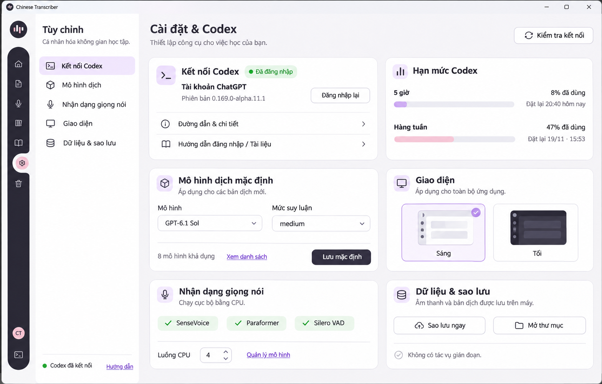

# Cài đặt & Codex — Bản thiết kế để duyệt

**Trạng thái: ĐÃ ĐƯỢC NGƯỜI DÙNG DUYỆT.** Người dùng yêu cầu triển khai bám sát ảnh sau khi chốt mẫu. Trang native được thực hiện tại `src/chinese_transcriber/settings_page.py`; các chỉnh sửa sidebar/dropdown từ những vòng trước giữ nguyên.



- Giữ nhận diện Pastel Light, sidebar capsule và hai cột trái có chiều rộng cố định khi chuyển trang.
- Tận dụng cột ngữ cảnh cho điều hướng các nhóm cài đặt; trên cửa sổ thiếu chiều cao, điều hướng đưa tới thẻ tương ứng trong vùng phải. Cột trái không có thanh cuộn riêng.
- Sáu thẻ: kết nối Codex, hạn mức, mặc định dịch, giao diện, nhận dạng cục bộ và dữ liệu/sao lưu.
- Thu gọn hướng dẫn đăng nhập và đường dẫn chi tiết. Đã đăng nhập thì ưu tiên trạng thái và nút đăng nhập lại.
- Thay danh sách model dài bằng lựa chọn mặc định và lối mở danh sách khả dụng. Model/effort vẫn phải xác minh với CLI khi triển khai.
- Hạn mức 8%/47% lấy từ ảnh người dùng để minh họa thiết kế, không phải lần đọc hạn mức mới.
- Ảnh mô tả cửa sổ rộng. Khi triển khai sau duyệt, màn hình thấp/hẹp vẫn cho cuộn vùng phải; giữ nguyên cấu trúc sidebar đã thống nhất.

Ảnh thiết kế gốc được tạo bằng công cụ **image_gen tích hợp** theo skill imagegen, tham chiếu màn hình người dùng gửi. Ảnh này giữ nguyên làm chuẩn sau khi duyệt. Ảnh đối chiếu là screenshot của widget PySide6 thật, không chỉnh sửa ảnh để giả kết quả triển khai.

## Prompt cuối

```text
Use case: ui-mockup.
Asset type: ONE high-fidelity desktop UI design image for the Vietnamese Windows application "Chinese Transcriber". This is a design for user approval, not application implementation.
Input image 1: EDIT TARGET and visual identity reference — the user's current Settings screen. Redesign its settings content and the white contextual navigation column, preserving the existing app brand and slim left icon rail.
Output: a crisp, straight-on, flat application screenshot, approximately 1600x1000 landscape, high resolution and highly legible Vietnamese typography. Show the complete Windows application window. No browser, desktop wallpaper, laptop device, perspective, decorative illustration, or external annotations.

Preserve invariants:
- Native Windows title bar with "Chinese Transcriber".
- Three-part shell: 82 px icon rail, 260 px white context column, remaining main workspace. These columns stay fixed. Do not add a hamburger.
- Dark graphite capsule rail #292636, circular waveform logo, seven small line icons with generous even spacing; Settings is active with the pink #F2BFCD circle in a notch that opens to the RIGHT/content side. Outer left spine stays continuous.
- CT avatar and terminal icon at the bottom aligned with the inactive icons, both centered in the dark capsule.
- Approved Pastel Light palette: main background #F6F5F7, white panels #FFFFFF, primary text #292633, secondary #696471, subtle borders #E9E6ED, lavender #EEE5FB, pale pink #FBE2E9. Rounded cards 18 px and fields 9 px; restrained shadow only. No saturated blue or neon.
- Clean Segoe UI/Noto Sans-like type, headings 18–26 px, body/controls 14 px, small metadata still readable. Exact Vietnamese diacritics. Realistic implementable native desktop controls.

Design objective: replace the current giant stacked forms, oversized blank areas, full-width utility buttons and long raw model list with a compact and clear settings overview. The most useful controls should fit in this desktop viewport. No nested scrollbars or clipped content.

LEFT CONTEXT COLUMN:
Heading "Tùy chỉnh"; subtitle "Cá nhân hóa không gian học tập".
A short, spacious vertical settings section navigation with small line icons:
"Kết nối Codex" (active, pale lavender rounded row),
"Mô hình dịch",
"Nhận dạng giọng nói",
"Giao diện",
"Dữ liệu & sao lưu".
At bottom a compact connection status with a green dot and "Codex đã kết nối", plus small "Hướng dẫn" link. This column does not scroll.

MAIN WORKSPACE:
Header: "Cài đặt & Codex", short subtitle "Thiết lập công cụ cho việc học của bạn." Right-aligned restrained outline button with refresh icon "Kiểm tra kết nối".
Below: SIX compact, neatly aligned white cards, arranged in three rows of two columns. Left column about 60% width and right about 40%, consistent 20 px gaps. Generous internal padding, no wasted tall empty cards.

ROW 1 — connection left, usage right, roughly 210 px height:
1. Connection card: small terminal icon in a lavender rounded square, title "Kết nối Codex", green soft badge "Đã đăng nhập". Main information "Tài khoản ChatGPT"; secondary "Phiên bản 0.169.0-alpha.11.1". Modest outline action "Đăng nhập lại". A light divider, then two compact inline disclosure/link rows "Đường dẫn & chi tiết" with chevron, and "Hướng dẫn đăng nhập" / "Tài liệu". Do NOT show a giant raw C:\Users path or four onboarding steps in the default view. No huge horizontal buttons.
2. Card title "Hạn mức Codex". Two clear slim horizontal progress bars with labels. First: "5 giờ" and "8% đã dùng"; lavender fill accurately only 8% of track; small reset "Đặt lại 20:40 hôm nay". Second: "Hàng tuần" and "47% đã dùng"; pale pink fill accurately 47%; small reset "Đặt lại 19/11 · 15:53". Reuse these numbers from the supplied screenshot as illustrative design data. No extra quota numbers or made-up account details.

ROW 2 — translation defaults left, appearance right, roughly 240 px height:
3. Title "Mô hình dịch mặc định", helper "Áp dụng cho các bản dịch mới". Two aligned fields side by side with clearly separated labels: "Mô hình" showing "GPT-6.1 Sol", and "Mức suy luận" showing "medium". Both fields have neat small chevrons and calm rounded borders. Underneath a compact line "8 mô hình khả dụng" and link "Xem danh sách". A small dark graphite primary button "Lưu mặc định" aligned bottom-right. No large list of eight models occupying the page.
4. Title "Giao diện". Two small elegant mode-preview selection tiles side by side, labelled "Sáng" and "Tối", each showing a tiny abstract app layout, not illustrations. Light selected with a subtle lavender outline and check. Helper "Áp dụng cho toàn bộ ứng dụng." Exactly two modes, no new System option.

ROW 3 — local ASR left, data right, roughly 170–185 px height:
5. Title "Nhận dạng giọng nói", small secondary "Chạy cục bộ bằng CPU". Three compact status chips with checkmarks: "SenseVoice", "Paraformer", "Silero VAD". Bottom line: "Luồng CPU" with small spinner showing "4"; link or compact secondary action "Quản lý mô hình".
6. Title "Dữ liệu & sao lưu". Short helper "Âm thanh và bản dịch được lưu trên máy." Two compact outlined buttons with icons: "Sao lưu ngay" and "Mở thư mục". A small muted line "Không có tác vụ gián đoạn". Do not invent last-backup dates.

Overall: polished, understated, practical productivity desktop software matching the supplied image's visual identity. Exact legible labels, consistent alignments and control heights, no visual clutter, no overlapping text, no gratuitous badges, no repeated giant Save buttons. Preserve left capsule notch shape and do not redesign other application screens.
```
